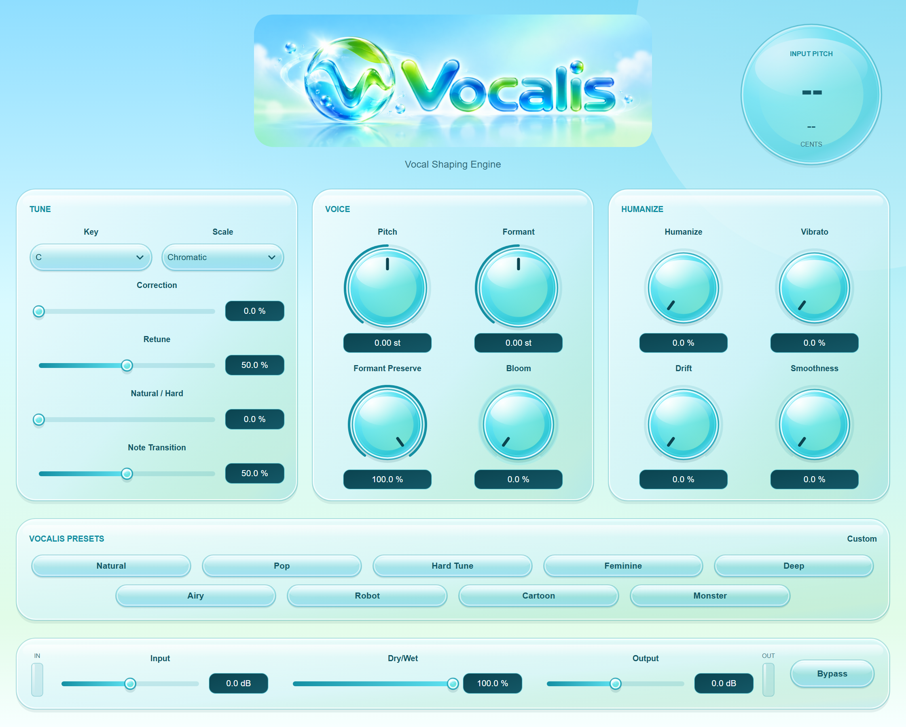

# Vocalis

Windows VST3 vocal processor with pitch correction, pitch and formant shifting, and humanization, built with JUCE.

## Overview

Vocalis shapes monophonic vocals through pitch correction, independent pitch/formant controls, and humanization. It targets Windows 10/11 x64 VST3 hosts, with FL Studio as the primary target. See the [release checklist](docs/ReleaseChecklist.md) for remaining manual checks.

## Features

- Mono/stereo vocal processing with manual pitch and independent formant shift.
- Monophonic automatic correction: C through B, Major, natural Minor, Chromatic.
- Humanize, vibrato preservation, drift and transition controls; Bloom macro.
- Nine editable factory presets, host automation and project state restoration.
- Resizable green/mint/aqua interface down to 900x700, keyboard Tab navigation,
  Pitch Orb and input/output meters.
- Aligned Dry/Wet and bypass; accurate fixed host latency compensation.

LIVE is the default and the mode used by the plugin. QUALITY remains functional
through the internal preparation API, with no UI selector or mode automation.
ULTRA30 is hidden research code, excluded from the production plugin. It is not
an available product feature. Plugin identity and all 18 parameter IDs are unchanged.

The [source audit and follow-up](docs/CurrentAudit.md) improve detector boundary
tracking and low/mid vocal octave detection, recover incomplete states
deterministically, reduce high-rate CPU peaks, and preserve compact UI value
fields. ZIP and installer packaging share regression and bundle-integrity checks.
A local review installer was built and validated; the published 1.0.0 download
has not been replaced with these changes.

## UI Preview

**Source-generated UI preview - not an actual application screenshot.**
Reconstructed from the UI source and supplied logo using static SVG rendering,
showing the default idle interface at 2x resolution (2240 x 1800). The application
was not launched; font rasterization and gradients may differ slightly at runtime.



## Technologies

C++17, JUCE 8.0.12, Signalsmith Stretch and Linear, VST3, CMake, and MSVC.

## Getting Started

Windows 10/11 x64, a Windows x64 VST3 host, and Microsoft Visual C++ v14 x64
runtime. Install the supported [Microsoft Redistributable](https://learn.microsoft.com/en-us/cpp/windows/latest-supported-vc-redist)
if needed. No separate JUCE or Signalsmith DLL or online service is required.
An ASIO audio interface is recommended for monitoring; its driver belongs to
FL Studio, not the plugin. The installer is unsigned. Download [Vocalis 1.0.0 Setup from the GitHub release](https://github.com/scryingorb/Vocalis/releases/tag/v1.0.0); run it with administrator approval. See [installer instructions](installer/README.md).

The GitHub release provides an installer and checksums, not the portable ZIP described below. The following manual-install steps apply only if you have built or obtained the local ZIP.

1. Close the host before replacing Vocalis.
2. Extract `Vocalis-1.0.0-Windows-x64.zip`.
3. Copy the **complete outer directory** `Vocalis.vst3` into
   `C:\Program Files\Common Files\VST3`. Administrator access may be required.
4. Retain the included README, notices and LICENSES. Do not copy only the inner
   `Contents\x86_64-win\Vocalis.vst3` module.

In FL Studio x64, open **Options > Manage plugins** (also accessible through
File settings), enable verification and rescan previously verified plugins,
then **Find installed plugins**. Add Vocalis to a Mixer effect slot through
**More plugins**. See [Image-Line installation instructions](https://www.image-line.com/fl-studio-learning/fl-studio-online-manual/html/basics_externalplugins.htm).
Use a recorded vocal first, then a microphone with headphones. Avoid feedback.
Save and reopen a project to verify restoration on your system.

### Build or run from source

C++17, JUCE 8.0.12, Signalsmith Stretch 1.3.2 and Signalsmith Linear 0.6.4;
MSVC, Windows SDK and CMake 3.24+. Revisions and bundled support libraries are
listed in [THIRD_PARTY_NOTICES.md](THIRD_PARTY_NOTICES.md).

```powershell
cmake -S . -B build -A x64 -DVOCALIS_BUILD_TESTS=ON
cmake --build build --config Release --target Vocalis_VST3 VocalisTests --parallel 2
ctest --test-dir build -C Release --output-on-failure
```

If a copied/moved workspace has a cache referring to an old path, configure a
fresh directory such as `build/audit` and use it in all three commands. Do not
reuse or manually rewrite the stale cache. The audit used the already-present
`tools/cmake-3.31.8-windows-x86_64/bin` tools when CMake was absent from PATH.

For an opt-in offline CPU matrix, run `VocalisTests.exe --audit-benchmark` from
the build directory. It writes `audit-cpu.csv` for 44.1/48/96 kHz, mono/stereo,
64/128/256/512-sample buffers, natural/hard tuning and automation. Its callback
timing is not an ASIO or DAW certification.

ZIP staging runs the current Release regression and checks the entire bundle
before copying. Use a new destination inside the project (existing packages are
never overwritten):

```powershell
powershell.exe -NoProfile -ExecutionPolicy Bypass -File tools/PackageRelease.ps1 -BuildDirectory build/audit -Destination dist/Vocalis-review
```

`-CTestPath` can select an existing CTest executable; otherwise PATH and the
local bundled CMake tool are checked. Unrelated entries in `SHA256SUMS.txt` are
retained. The installer helper uses the same current-test and complete-bundle
hash checks; actual installation/upgrade/uninstall acceptance remains manual.

To build a review installer with Inno Setup installed, use a fresh output directory:

```powershell
powershell.exe -NoProfile -ExecutionPolicy Bypass -File installer/BuildInstaller.ps1 -BuildDirectory build/audit -OutputDirectory build/audit/installer-review
```

Use CMake on PATH. To select VS 2022 explicitly, use `-G "Visual Studio 17 2022"`
and a separate build directory. Missing external source directories trigger
pinned dependency downloads. Development tools/source are not in the binary ZIP.
Release bundle: `build/Vocalis_artefacts/Release/VST3/Vocalis.vst3`.
Package: `dist/Vocalis-1.0.0-Windows-x64.zip`; checksums: `dist/SHA256SUMS.txt`.

## Usage

| Control | Behavior |
|---|---|
| Input | -24 to +24 dB gain into the processed path; raw dry/bypass stays clean |
| Dry/Wet | 0–100% time-aligned blend |
| Output | -24 to +24 dB after the blend; bypass returns aligned clean input |
| Bypass | Smoothed aligned bypass; does not remove plugin latency |
| Pitch | -12 to +12 semitones, fractional values supported |
| Formant | -6 to +6 semitones of vocal envelope character |
| Formant Preserve | 0–100% compensation for timbre changes caused by pitch shift |
| Key / Scale | Allowed notes for automatic correction; Minor means natural minor |
| Correction | 0–100% tuning strength; zero disables correction |
| Retune | Higher values follow the tuning target faster |
| Note Transition | Softens movement between targets |
| Natural / Hard | Higher values produce tighter, more obvious instantaneous tuning |
| Humanize | Preserves movement and softens centering/transitions |
| Vibrato | Retains natural input vibrato during correction |
| Drift | Retains subtle bounded input-derived slow variation; not random noise |
| Smoothness | Softens note transitions through Humanize processing |
| Bloom | Macro affecting Humanize, Vibrato, Smoothness and formant character |

Pitch changes musical note; formants change the resonant vocal character.
Preserve counteracts pitch-induced envelope movement, while Formant adds an
intentional independent shift. Large changes can sound artificial.

Choose the vocal's key/scale, keep manual Pitch/Formant at zero and Preserve at
100%, then raise Correction. A gentle starting point is Correction 70%, Retune
40%, Note Transition 60%, Natural/Hard 0%. For obvious hard tuning try 100%,
100%, 0%, 100% respectively. Reference tuning is A4=440 Hz. The Pitch Orb shows
input pitch when correction is enabled. Manual Pitch transposes the corrected
result. Detection follows the left channel for stereo; use mono for right-only
vocals. Humanize refinements need correction enabled to affect tuning.

Bloom is not another Dry/Wet control. It changes effective control values while
the individual knobs retain their editable base values. It adds up to +0.75 st
of formant character. Bloom does not change gain.

## Presets

Natural, Pop, Hard Tune, Feminine, Deep, Airy, Robot, Cartoon and Monster use
normal plugin parameters. Key/Scale remain unchanged during recall. Edit any
control after loading; matching capsules glow, otherwise the sound is Custom.
Project save/reload restores parameter values and the matching indication.
Processing quality is independent of creative preset choice.

## Latency and limitations

| Rate | LIVE samples / ms | QUALITY samples / ms (internal) |
|---|---:|---:|
| 44.1 kHz | 2180 / 49.4331 | 5356 / 121.4512 |
| 48 kHz | 2368 / 49.3333 | 5824 / 121.3333 |
| 88.2 kHz | 4561 / 51.7120 | 10648 / 120.7256 |
| 96 kHz | 4960 / 51.6667 | 11584 / 120.6667 |

Host compensation aligns playback tracks; it cannot remove monitoring delay.
Total monitoring delay also includes interface input/output and host/ASIO
buffers. Approximately 49–52 ms plugin delay is significant for live singing.
At 88.2/96 kHz, spectral work is spread across a hop to reduce callback peaks;
the additional 3 ms is included in reported latency. Lower-rate scheduling is
unchanged. The editor can resize down to 900x700 and has explicit Tab navigation.

- Correction assumes a single vocal, not chords or full mixes. Noise, breath,
  weak fundamentals and changing notes can cause detection/octave errors.
- Extreme pitch/formant transformations can produce metallic sound, smearing,
  flutter or other artifacts. Broader human vocal validation remains pending.
- No released ULTRA low-latency mode, and no user-facing quality selector.
- No limiter: loud input, positive gain and processing peaks can exceed 0 dBFS.
  Leave headroom. Near-full-scale test speech produced slight production overs.
- Very small high-rate host buffers can miss deadlines on this machine; raise
  buffer size if needed. Offline automated timing is not ASIO certification.
- Prepare/reset/bus changes require host serialization. Preset changes publish
  separate parameter updates rather than a single atomic transaction.
- Windows x64 VST3 only. Clean-machine, FL Studio reopen/automation and human
  listening checks must be completed before final public release.

## Project Status

Released on GitHub as version 1.0.0; the repository still identifies the engine as a release candidate. Manual host/listening, clean-machine, and licensing sign-off remain pending.

The current source passed the full automated regression, an additional 354-case
pitch-detector sweep, and installer build/version/checksum validation. The
[audit results](docs/CurrentAudit.md) include measured CPU improvements and their
latency tradeoff. These checks do not replace manual DAW and vocal listening tests.

## License

Retain THIRD_PARTY_NOTICES.md and all LICENSES, including bundle resource copies.
JUCE's commercial/AGPL licensing route must be confirmed by the owner; including
notices does not alone satisfy AGPL source obligations. No JUCE entitlement was
verified. Owner-provided proprietary terms are in [LICENSE.txt](LICENSE.txt). See the [JUCE 8 licence](https://juce.com/legal/juce-8-licence/).
This RC package is a technical delivery, not public/commercial legal clearance.

The source remains a release candidate pending manual sign-off and distribution
approval. The latest audit contains focused maintenance fixes, with no new
parameters, dependencies or alternate production engine.
